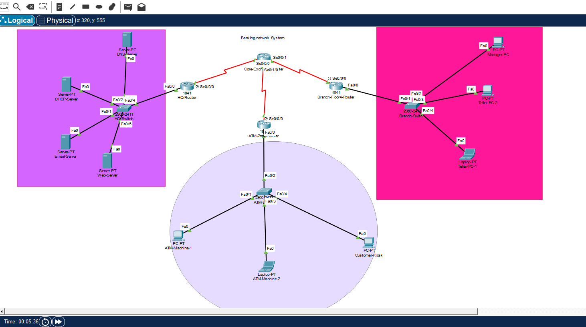
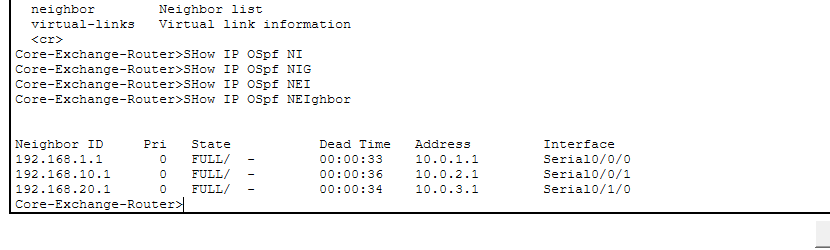
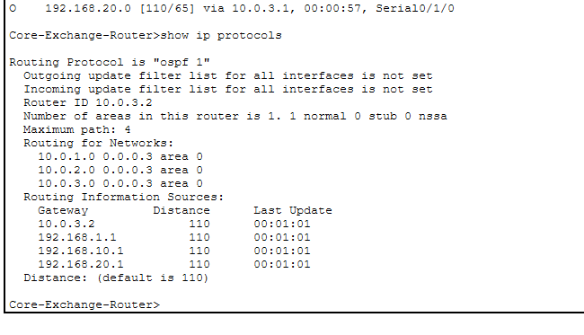
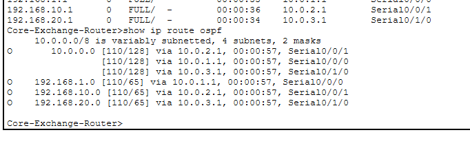

# Secure Enterprise Banking Network Infrastructure

A Cisco Packet Tracer project focused on designing and simulating an enterprise banking network with interconnected headquarters, branch office, and ATM infrastructure.

The project explores how different network segments communicate through a central routing infrastructure while supporting essential banking-related services such as DHCP, DNS, web hosting, and email communication.

## Project Overview

This project was developed as part of my Computer Science and Engineering academic work. The main objective was to design a network infrastructure that connects different banking departments and remote locations through a central core network.

The network uses Cisco routers and switches to establish communication between the headquarters, branch office, and ATM environment. OSPF provides dynamic routing between the connected network segments.

I also configured centralized network services to support IP address allocation, domain name resolution, web access, and email communication.

## Network Architecture

The simulated network consists of three main zones connected through a central Core-Exchange Router.
### Network Topology

The following diagram illustrates the complete network architecture, including the headquarters, branch office, ATM zone, and their connections through the central Core-Exchange Router.



### 1. Headquarters (HQ)

The headquarters network contains the central servers and network infrastructure.

**Components:**
- HQ Router
- HQ Switch
- DHCP Server
- DNS Server
- Web Server
- Email Server

### 2. Branch Office

The branch office represents the operational environment of a banking branch.

**Components:**
- Branch Floor 4 Router
- Branch Switch
- Manager PC
- Teller PC-1
- Teller PC-2

### 3. ATM and Customer Kiosk Network

This section represents the ATM infrastructure and customer access environment.

**Components:**
- ATM Zone Router
- ATM Switch
- ATM Machine-1
- ATM Machine-2
- Customer Kiosk

### 4. Core Network

The Core-Exchange Router connects the three network zones through serial WAN interfaces.

It provides the central routing point for communication between the headquarters, branch office, and ATM network.

## Technologies and Protocols

| Technology | Purpose |
|---|---|
| Cisco Packet Tracer | Network design and simulation |
| OSPFv2 | Dynamic routing |
| IPv4 | Network addressing |
| DHCP | Automatic IP address assignment |
| DHCP Relay | Forwarding DHCP requests across network segments |
| DNS | Domain name resolution |
| HTTP | Web server access |
| SMTP / POP3 | Email communication |
| Serial WAN | Interconnection between network routers |

## Routing Configuration

### OSPF Implementation

OSPFv2 was configured to provide dynamic routing between the connected network segments.

**Verified Core-Exchange Router configuration:**

| Parameter | Configuration |
|---|---|
| OSPF Process ID | 1 |
| Router ID | 10.0.3.2 |
| OSPF Area | Area 0 |
| Administrative Distance | 110 |
| Maximum Paths | 4 |

### Core Router WAN Interfaces

The following interface addresses were verified using the Cisco IOS command `show ip interface brief`.

| Interface | IP Address | Status |
|---|---|---|
| Serial0/0/0 | 10.0.1.2 | Up/Up |
| Serial0/0/1 | 10.0.2.2 | Up/Up |
| Serial0/1/0 | 10.0.3.2 | Up/Up |

All three serial interfaces were operational during verification.

### OSPF Neighbor Verification



The Core-Exchange Router successfully established three OSPF neighbor relationships.

| Neighbor Router ID | Neighbor Address | Local Interface | State |
|---|---|---|---|
| 192.168.1.1 | 10.0.1.1 | Serial0/0/0 | FULL |
| 192.168.10.1 | 10.0.2.1 | Serial0/0/1 | FULL |
| 192.168.20.1 | 10.0.3.1 | Serial0/1/0 | FULL |

All three neighbors reached the FULL adjacency state.

### OSPF Network Statements


The verified OSPF configuration includes the following networks in Area 0:

```cisco
router ospf 1
 network 10.0.1.0 0.0.0.3 area 0
 network 10.0.2.0 0.0.0.3 area 0
 network 10.0.3.0 0.0.0.3 area 0
```

The Core-Exchange Router also learned the following LAN network routes through OSPF:



- 192.168.1.0
- 192.168.10.0
- 192.168.20.0

## Network Services

### DHCP

A centralized DHCP server was configured to provide automatic IP address allocation to network clients. DHCP relay functionality supports communication with the server across different network segments.

### DNS

A DNS server was configured to resolve domain names for accessing network services.

### Web Server

An HTTP service was configured to host the banking website within the simulated network.

### Email Server

SMTP and POP3 services were configured to support email communication between banking employees.

## Testing and Verification


The project was tested using Cisco Packet Tracer simulation and connectivity checks.

The project report documents the following results:


| Test | Result |
|---|---|
| ATM Machine-1 to Web Server ping | Successful |
| ICMP packets received | 4 out of 4 |
| Packet loss | 0% |
| Banking website access | Successful |
| DNS name resolution | Successful |
| Teller-to-Manager email delivery | Successful |

OSPF neighbor relationships and learned routes were also checked directly through Cisco IOS commands.


## Verification Evidence

The following screenshots document the network configuration, routing verification, connectivity tests, and application services tested during the Cisco Packet Tracer simulation.

### 1. OSPF and Routing Verification

- [OSPF Neighbor Adjacencies](evidence/ospf-neighbors.png)
- [OSPF Protocol Configuration](evidence/ospf-protocols.png)
- [OSPF Routing Table](evidence/ospf-routing-table.png)

### 2. Network Connectivity and Services

- [ATM Machine-2 to Web Server Connectivity](evidence/atm-machine-2-to-web-server-png.png)
- [DHCP Configuration and IP Assignment](evidence/dhcp-atm-machine-2.png)
- [DNS Server Records](evidence/dns-server-records.png)
- [DNS Name Resolution](evidence/dns-resolution-atm-machine-2.png)
- [HTTP Banking Website Access](evidence/http-banking-website-atm-machine-2.png)

### 3. Email Communication

- [SMTP and POP3 Server Configuration](evidence/email-server-smtp-pop3.png)
- [Email Received on Teller-PC-1](evidence/email-received-on-teller-pc-1.png)
- [Email Received on Manager-PC](evidence/email-received-on-manager-pc.png)


## Useful Cisco IOS Verification Commands

The following commands were used to inspect and verify the network configuration:

```cisco
show ip interface brief
show ip ospf neighbor
show ip route ospf
show ip protocols
```

These commands help verify interface status, OSPF adjacency, learned routes, and routing protocol configuration.

## Project Files

| File | Description |
|---|---|
| `Banking-network-system.pkt` | Cisco Packet Tracer network simulation |

## How to Open the Project

1. Download the `.pkt` file from this repository.
2. Install Cisco Packet Tracer.
3. Open Cisco Packet Tracer.
4. Select File → Open.
5. Choose `Banking-network-system.pkt`.
6. Explore the network topology and device configurations.

## Learning Outcomes

Through this project, I gained practical experience in:

- Designing an interconnected enterprise network.
- Configuring and verifying OSPF dynamic routing.
- Understanding WAN connectivity between network segments.
- Working with centralized DHCP and DNS services.
- Configuring web and email services.
- Testing network connectivity and troubleshooting configuration issues.
- Understanding how different components of an enterprise network work together.

## Project Information

**Project Type:** Academic Networking Project

**Platform:** Cisco Packet Tracer

**Author:** Shihab Patowary

**Institution:** Southeast University, Bangladesh

---

This repository contains an academic network simulation for learning and demonstration purposes. It is not a production banking network deployment.

*Built through practical networking exercises, configuration, and testing.*
